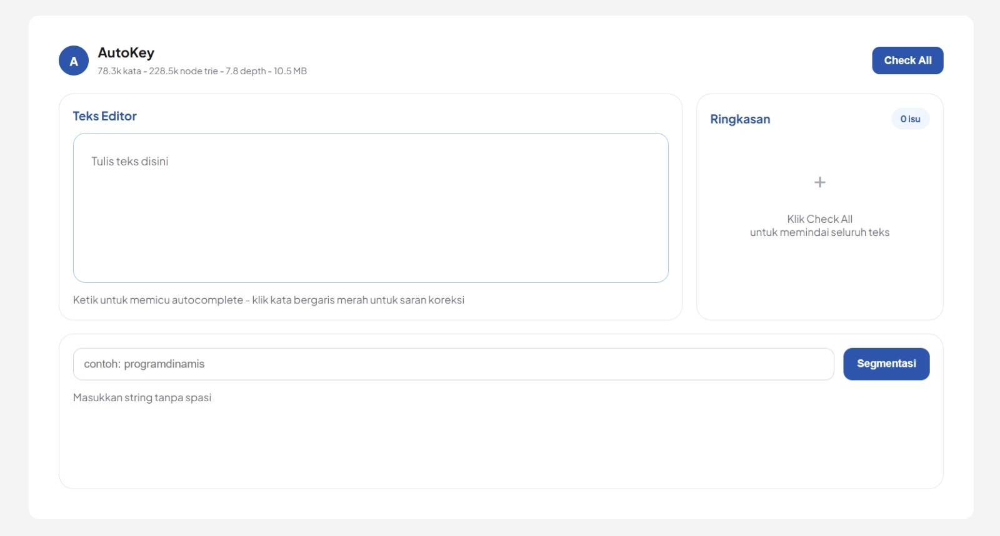

# AutoKey-13524097

<p align="center">
  
</p>

AutoKey adalah teks editor web dengan fitur autocomplete, spell check, Check All, dan Auto-Space yang menggunakan Trie untuk pencarian prefix dan validasi kata, Levenshtein Edit Distance untuk saran koreksi kata, dan Dynamic Programming untuk Word Segmentation.

## Fitur Program
- Load dataset `kamus.json` saat backend dijalankan
- Build Trie sebagai struktur data kamus
- Menampilkan statistik Trie yaitu,
  - jumlah kata
  - jumlah node
  - avarage trie depth
  - estimate memory usage
- Autocomplete top-5 berdasarkan prefix
- Pilih autocomplete pertama dengan `Tab` atau `Enter`
- Spell check di editor dengan garis bawah merah untuk kata salah
- Popup saran koreksi dari Levenshtein Edit Distance
- Tambah kata ke kamus
- Check All untuk memindai seluruh teks
- Auto-Space untuk memecah string tanpa spasi dan menampilkan hasil Word Segmentation, array `dp[]`, dan proses trace-back

## Tech Stack
- Backend: Python
- Frontend: Next.js

## Cara Menjalankan Program
Jalankan backend:
```bash
cd backend
python -m uvicorn Api:app --reload
```

Jalankan frontend:
```bash
cd frontend
npm install
npm run dev
```

Buka aplikasi di browser:
```txt
http://localhost:3000
```

Pastikan backend berjalan di:
```txt
http://127.0.0.1:8000
```

## Struktur Program
```txt
AutoKey-13524097
├── backend
│   ├── Api.py
│   ├── Loader.py
│   ├── Main.py
│   ├── Trie.py
│   ├── Levenshtein.py
│   ├── Segmentation.py
│   └── data
│       └── kamus.json
│
└── frontend
    └── app
        ├── components
        │   ├── Header.js
        │   ├── EditorPanel.js
        │   ├── SummaryPanel.js
        │   └── ToolPanel.js
        └── styles
            ├── header.css
            ├── editor-panel.css
            ├── summary-panel.css
            ├── tool-panel.css
            └── layout.css
```

`Loader.py` membaca `kamus.json`. Data kamus disimpan ke `DATA` di `Main.py`. Setelah itu semua kata dimasukkan ke `TRIE`. Trie dipakai untuk autocomplete, search kata, spell check, dan statistik. Levenshtein dipakai saat kata tidak ditemukan di Trie. Word Segmentation memakai `DATA` dan total frekuensi kata `N_WORDS`.

## Trie
Trie dibuat di `Trie.py`dimana setiap node Trie menyimpan `children` dalam bentuk dictionary dan `is_end_word` untuk menandai akhir kata.

Fungsi utama Trie:
- `insert(word)` untuk memasukkan kata ke Trie
- `search(word)` untuk mengecek apakah kata valid
- `has_prefix(word)` untuk mengecek apakah prefix ada
- `get_suggestions(word, n, data)` untuk autocomplete

Pada autocomplete, backend masuk ke node terakhir dari prefix lalu melakukan DFS untuk mengambil semua kata yang berawalan prefix tersebut. Setelah itu, kata diurutkan berdasarkan frekuensi dari `DATA` dan diambil 5 teratas.

## Levenshtein Edit Distance
Levenshtein Edit Distance digunakan untuk menghitung jarak minimum antara dua kata. Operasi yang digunakan adalah insert, delete, dan replace. Algoritma ini dipakai untuk mencari saran koreksi saat user mengetik kata yang salah. Implementasinya ada di `Levenshtein.py`, pada fungsi Levenshtein(word1, word2)`. Fungsi ini membuat tabel DP berukuran `(m + 1) x (n + 1)`, dengan `m` panjang `word1` dan `n` panjang `word2`

Basis:
```txt
dp[i][0] = i
dp[0][j] = j
```

Relasi rekurens:
```txt
dp[i][j] = min(dp[i - 1][j] + 1, dp[i][j - 1] + 1, dp[i - 1][j - 1] + cost)
```

Fungsi `get_levenshtein_words` mencari kata di kamus dengan distance <= 2 kemudian diurutkan berdasarkan distance paling kecil, lalu frekuensi paling besar. Dari hasil tersebut akan diambil 5 saran teratas

## Word Segmentation
Word Segmentation digunakan untuk memecah string tanpa spasi menjadi kata-kata valid. Contoh:

```txt
programdinamis -> program dinamis
```

Implementasinya ada di `Segmentation.py`. Program membuat array `dp` berukuran `m + 1`, dengan `m` sebagai panjang input. Nilai `dp[i]` menyimpan cost minimum untuk memecah string dari awal sampai indeks `i`

Basis:
```txt
dp[0] = 0
```

Relasi rekurens:
```txt
dp[i] = min(dp[j] + cost(word[j:i]))
```

untuk setiap `j < i` dengan syarat `word[j:i]` ada di kamus

Rumus cost:
```txt
cost(w) = log(total_words / freq(w))
```

Kata dengan frekuensi lebih besar memiliki cost lebih kecil sehingga lebih diprioritaskan. Program juga menyimpan `segmented_idx` untuk melakukan trace-back. Auto-Space menampilkan hasil segmentasi, array `dp[]`, dan proses trace-back pada UI

## Link Video Demo
Link video: https://drive.google.com/file/d/1v-lVby886Jju23B1hO1gJVbWyMTzE1WP/view?usp=sharing 

## Referensi
- KBBI V Dataset — aryakdaniswara/kbbi-dataset-kbbi-v
- Frequency Distribution Bahasa Indonesia dari korpus Wikipedia — ardwort/freq-dist-id
- Trie (insert & search) — GeeksforGeeks: Trie | (Insert and Search)
- Levenshtein Edit Distance — GeeksforGeeks: Edit Distance